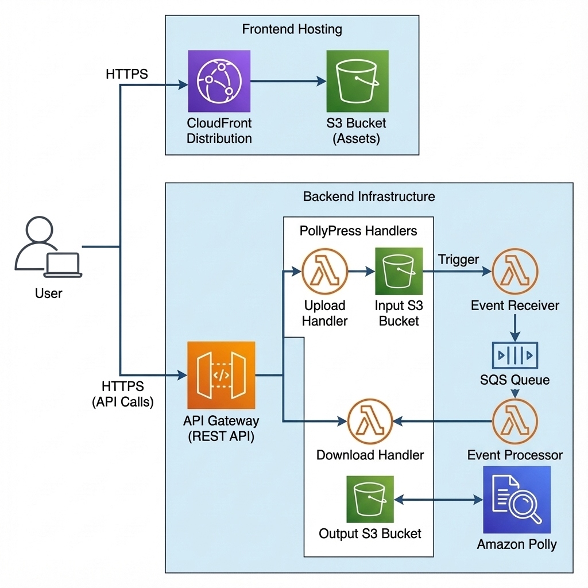

# PollyPress

A serverless text-to-speech application built with AWS CDK, React, API Gateway, Lambda, and Amazon Polly.



## Features
- **Serverless Architecture**: Fully serverless backend using AWS Lambda and API Gateway.
- **React Frontend**: Interactive frontend built with Vite and React.
- **Text-to-Speech**: Converts text files to audio using Amazon Polly.
- **Asynchronous Processing**: Scalable event-driven architecture with SQS.
- **Infrastructure as Code**: Complete infrastructure defined in AWS CDK.
- **Secure Hosting**: Frontend delivered via CloudFront and S3 with HTTPS.

## Architecture

The system follows a clean, serverless architecture:
1.  **Frontend**: Users access the React application hosted on S3 and served via CloudFront.
2.  **API**: API Gateway routes RESTful requests to specific Lambda handlers.
3.  **Logic**: Node.js Lambda functions handle uploads, downloads, and event processing.
4.  **Processing**: SQS and Lambda coordinate with Amazon Polly for speech synthesis.
5.  **Storage**: S3 stores input text files and output audio files.

## Prerequisites

- Node.js (v22.x)
- AWS CLI configured with appropriate credentials (profile `promie`)
- AWS CDK installed globally (`npm install -g aws-cdk`)

## Quick Start

1.  **Install Dependencies**
    ```bash
    npm install
    ```

2.  **Deploy to AWS**
    ```bash
    npm run deploy
    ```

3.  **Run Frontend Locally**
    ```bash
    npm run dev
    ```

## Passcode

The app is private: `/upload` and `/download` require a shared passcode, sent as
an `Authorization: Passcode <code>` header. The web app asks for it once and
remembers it on that device until **Lock on this device** is clicked.

The passcode lives in AWS Secrets Manager as `PollyPress-staging-passcode`. It is
generated randomly on the first deploy.

**Show the current passcode**

```bash
aws secretsmanager get-secret-value \
  --secret-id PollyPress-staging-passcode \
  --profile promie \
  --query SecretString \
  --output text
```

**Change the passcode**

```bash
aws secretsmanager put-secret-value \
  --secret-id PollyPress-staging-passcode \
  --profile promie \
  --secret-string 'your-new-passcode'
```

No redeploy is needed. The new passcode takes effect within about 5 minutes, and
anyone still using the old one is asked for the new one. Use single quotes so the
shell doesn't interpret characters like `!`, `#` or `^`.

## Cost Controls

Amazon Polly bills per character (neural voices are about US$16 per million), so
the backend has limits. Set these in a `.env` file at the repo root (not committed):

| Variable | Default | Purpose |
| :--- | :--- | :--- |
| `DAILY_CHARACTER_LIMIT` | `1000000` | Hard cap on characters converted per UTC day (~$16). Larger documents are rejected. |
| `BUDGET_MONTHLY_USD` | `10` | Monthly Polly budget for email alerts at 50%, 80%, 100% and forecast overrun. |
| `BUDGET_ALERT_EMAIL` | none | Where budget alerts are sent. No budget is created if unset. |

API Gateway also throttles requests: 20 per second overall, and 1 per second
(burst 3) for uploads.

## API Endpoints

| Method | Endpoint | Auth | Description |
| :--- | :--- | :--- | :--- |
| `POST` | `/upload` | Passcode | Request presigned upload URL |
| `GET` | `/download` | Passcode | Get processing progress, or a presigned MP3 download URL when ready |
| `GET` | `/auth/check` | Passcode | Check that a passcode is valid |
| `GET` | `/status` | Public | API health check |

## Project Structure

- `frontend/`: React application and assets.
- `app/`: Lambda handlers and business logic.
- `infra/`: AWS CDK infrastructure stacks and constructs.

The `cdk.json` file tells the CDK Toolkit how to execute your app.

## Useful commands

* `npm run build`   compile typescript to js
* `npm run watch`   watch for changes and compile
* `npm run test`    perform the jest unit tests
* `npx cdk deploy`  deploy this stack to your default AWS account/region
* `npx cdk diff`    compare deployed stack with current state
* `npx cdk synth`   emits the synthesized CloudFormation template
